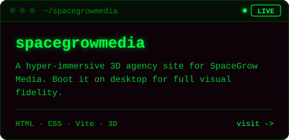

<div align="center">


<br>

[](https://spacegrowmedia.com) [](https://mezvo-scan.vercel.app)

</div>


```console
nishit@zion:~$ whoami --long
```

- Built **[SpaceGrow Media](https://spacegrowmedia.com)**, a hyper-immersive 3D agency site (boot it on desktop for the full effect)
- Shipped **[Mezvo Scan](https://mezvo-scan.vercel.app)**, the offline-first barcode PWA a bag brand runs its stalls on: sell with no signal, sync when it returns, print tags to a Bluetooth thermal printer
- Build **AI pipelines** with Claude, Gemini, LangChain and multi-agent systems
- Experimenting with **React Native**, **computer vision** and **agentic workflows**
- Rule: ship real products, not side quests





<p align="center">
  <a href="https://mezvo-scan.vercel.app"></a>
  <a href="https://spacegrowmedia.com"></a>
  <a href="https://github.com/nishitjayne/ai-lead-qualifier"></a>
  <a href="https://github.com/nishitjayne/readyai"></a>
  <a href="https://github.com/nishitjayne/knowledge-bounty"></a>
  <a href="https://github.com/nishitjayne/velmessa"></a>
</p>

<br>

<details>
<summary><b>&gt; ls ~/archive</b> &nbsp;·&nbsp; the rest of the repos</summary>
<br>

| Repo | What it is | Built with |
|---|---|---|
| [attendance-system](https://github.com/nishitjayne/attendance-system) | Contactless attendance by real-time face recognition, logged to Excel | Python · OpenCV · pandas · Flask |
| [lendenclub-identitymicro-service](https://github.com/nishitjayne/lendenclub-identitymicro-service) | User profile and access control service | Node.js · JWT · AES-256 |
| [miniproject](https://github.com/nishitjayne/miniproject) | Small web builds: face attendance, food shop, AI learning page | HTML · JS |
| canadian-realty | Real-estate site for a client (private, happy to demo on a call) | JavaScript |
| [nishitjayne](https://github.com/nishitjayne/nishitjayne) | This page: generated SVGs and a six-hourly Actions job | Node · Actions |

</details>

<br>


<div align="center">


**[🔴 Red pill: see how deep SpaceGrow goes](https://spacegrowmedia.com)** &nbsp;&nbsp;·&nbsp;&nbsp; **[🔵 Blue pill: open Mezvo Scan](https://mezvo-scan.vercel.app)**

</div>
