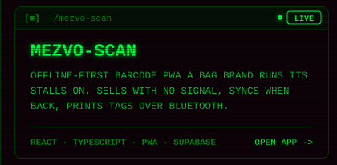
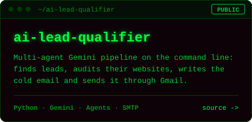
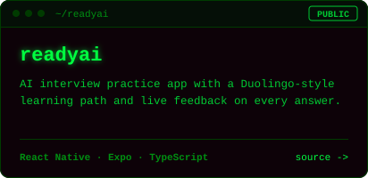
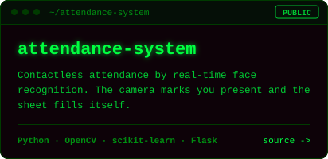
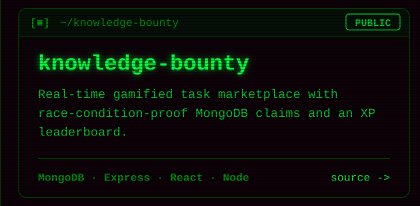
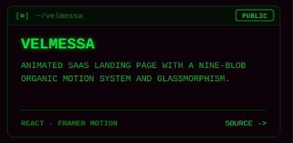
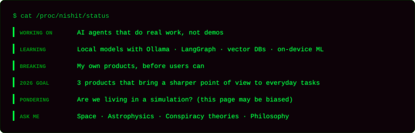
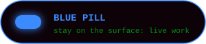

<div align="center">



</div>


```console
nishit@zion:~$ whoami --long
```

- AI engineer who works the whole stack: models and agents at one end, the screen someone taps at the other
- I build for real constraints: a stall with no signal, a back office that runs on SAP, a camera that has to recognise a face in real time
- Happiest when a problem doesn't fit one box. An LLM pipeline this week, a barcode PWA the next
- Off the keyboard: space, astrophysics, philosophy, and the odd conspiracy theory
- Rule: ship it, watch it get used, fix what breaks


<p align="center">
  <a href="https://mezvo-scan.vercel.app"></a>
  <a href="https://github.com/nishitjayne/ai-lead-qualifier"></a>
  <a href="https://github.com/nishitjayne/readyai"></a>
  <a href="https://github.com/nishitjayne/attendance-system"></a>
  <a href="https://github.com/nishitjayne/knowledge-bounty"></a>
  <a href="https://github.com/nishitjayne/velmessa"></a>
</p>

<br>

<details>
<summary><b>&gt; ls ~/archive</b> &nbsp;·&nbsp; the rest of the repos</summary>
<br>

| Repo | What it is | Built with |
|---|---|---|
| [lendenclub-identitymicro-service](https://github.com/nishitjayne/lendenclub-identitymicro-service) | User profile and access control service | Node.js · JWT · AES-256 |
| [miniproject](https://github.com/nishitjayne/miniproject) | Small web builds: face attendance, food shop, AI learning page | HTML · JS |
| canadian-realty | Real-estate site for a client (private, happy to demo on a call) | JavaScript |
| [nishitjayne](https://github.com/nishitjayne/nishitjayne) | This page: generated SVGs and a six-hourly Actions job | Node · Actions |

</details>

<br>




<div align="center">


<a href="https://nishitjayne.github.io/nishitjayne/red.html"></a> &nbsp;&nbsp; <a href="https://nishitjayne.github.io/nishitjayne/blue.html"></a>

</div>
